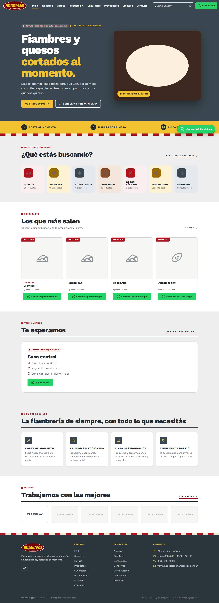

# Guía del sitio de Boggiano Fiambrerías

Cómo dejar listo el sitio **[boggianofiambrerias.com.ar](https://boggianofiambrerias.com.ar)**, cómo se usa el panel de administración y qué cambia en la web con cada cosa que tocás.

El panel está en **[boggianofiambrerias.com.ar/admin](https://boggianofiambrerias.com.ar/admin)**. Se entra con un usuario y contraseña; si todavía no tenés uno, pedíselo a quien administra el sitio.

> Las capturas de esta guía son de una copia de prueba, con datos de ejemplo. Los nombres y mails de las postulaciones son ficticios.

## Para dejar el sitio listo

Hoy el sitio está publicado pero con **datos de ejemplo**. En este orden:

**Urgente**
- [ ] **WhatsApp real.** Mientras diga `5490000000000`, cada botón "Consultar" lleva a un número que no existe. → [Datos del negocio](guia/02-datos-del-negocio.md)
- [ ] **Teléfono, Instagram y Facebook.** → [Datos del negocio](guia/02-datos-del-negocio.md)
- [ ] **Casillas de correo:** `ventas@` (con la contraseña que tiene cargada el sitio) y el alias `empleos@`. Sin ellas, los avisos de mensajes y CV no salen. → [Correo](guia/12-correo.md)

**Contenido**
- [ ] **Sucursales:** dirección, horarios y mapa de cada una. → [Sucursales](guia/06-sucursales.md)
- [ ] **Catálogo real**, cargado desde Excel, y **fotos** de los productos (se pueden subir todas juntas con *Fotos en lote*). Borrá u ocultá los de ejemplo que no vendas. → [Importar](guia/04-importar-exportar.md) · [Fotos en lote](guia/03-productos.md#subir-muchas-fotos-juntas-fotos-en-lote)
- [ ] **Marcas reales** con su logo. "Marca 2" a "Marca 6" son de ejemplo. → [Marcas](guia/07-marcas.md)
- [ ] **Búsquedas laborales:** las dos que hay son de ejemplo. → [Empleos](guia/08-empleos-y-postulaciones.md)
- [ ] **Historia en Nosotros**, más las fotos de portada y de Nosotros. → [Textos e imágenes](guia/10-textos-e-imagenes.md)
- [ ] Borrar el mensaje **"PRUEBA del sistema"**. → [Mensajes](guia/09-mensajes.md)

**Para cerrar**
- [ ] Apagar la barra amarilla **"Versión de prueba"**. → [Datos del negocio](guia/02-datos-del-negocio.md)
- [ ] Crear un **segundo usuario** del panel, por si alguien olvida su contraseña. → [Usuarios](guia/11-usuarios.md)
- [ ] Dar de baja la **tienda vieja** y cambiar el link en Instagram, Google y donde esté publicado.

## Quiero cambiar…

| Qué | Dónde, en el panel | Guía |
|---|---|---|
| WhatsApp, teléfono, mails, redes | Datos del negocio | [02](guia/02-datos-del-negocio.md) |
| Un producto, su foto o si es destacado | Productos | [03](guia/03-productos.md) |
| Muchos productos a la vez | Importar / Exportar | [04](guia/04-importar-exportar.md) |
| Muchas fotos a la vez | Productos → Fotos en lote | [03](guia/03-productos.md#subir-muchas-fotos-juntas-fotos-en-lote) |
| Las categorías o el menú "Productos" | Categorías | [05](guia/05-categorias.md) |
| Direcciones, horarios, mapas | Sucursales | [06](guia/06-sucursales.md) |
| Los logos de las marcas | Marcas | [07](guia/07-marcas.md) |
| Las búsquedas de empleo / ver CV | Empleos · Postulaciones | [08](guia/08-empleos-y-postulaciones.md) |
| Responder una consulta | Mensajes | [09](guia/09-mensajes.md) |
| Un texto de cualquier página, el logo, las fotos grandes | Textos e imágenes | [10](guia/10-textos-e-imagenes.md) |
| Quién puede entrar al panel | Usuarios | [11](guia/11-usuarios.md) |
| Leer los mails de las casillas | Webmail o Gmail | [12](guia/12-correo.md) |
| Respaldos y qué no tocar | — | [13](guia/13-mantenimiento.md) |

## Índice

1. [Entrar al panel](guia/01-entrar-al-panel.md)
2. [Datos del negocio](guia/02-datos-del-negocio.md)
3. [Productos](guia/03-productos.md)
4. [Importar y exportar productos (Excel)](guia/04-importar-exportar.md)
5. [Categorías y menú de productos](guia/05-categorias.md)
6. [Sucursales](guia/06-sucursales.md)
7. [Marcas](guia/07-marcas.md)
8. [Empleos y postulaciones](guia/08-empleos-y-postulaciones.md)
9. [Mensajes](guia/09-mensajes.md)
10. [Textos e imágenes](guia/10-textos-e-imagenes.md)
11. [Usuarios](guia/11-usuarios.md)
12. [Correo](guia/12-correo.md)
13. [Mantenimiento y respaldos](guia/13-mantenimiento.md)

## Cómo funciona el sitio, en dos líneas

Todo lo que se ve en la web sale del panel: lo que guardás aparece en el sitio **al instante**, sin publicar nada aparte. Si no ves un cambio, recargá la página. En el celular a veces hace falta cerrar la pestaña y volver a abrirla.
