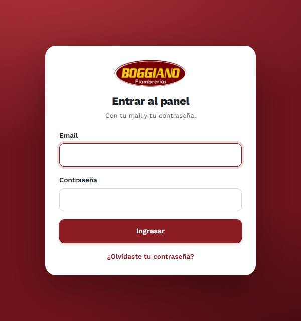
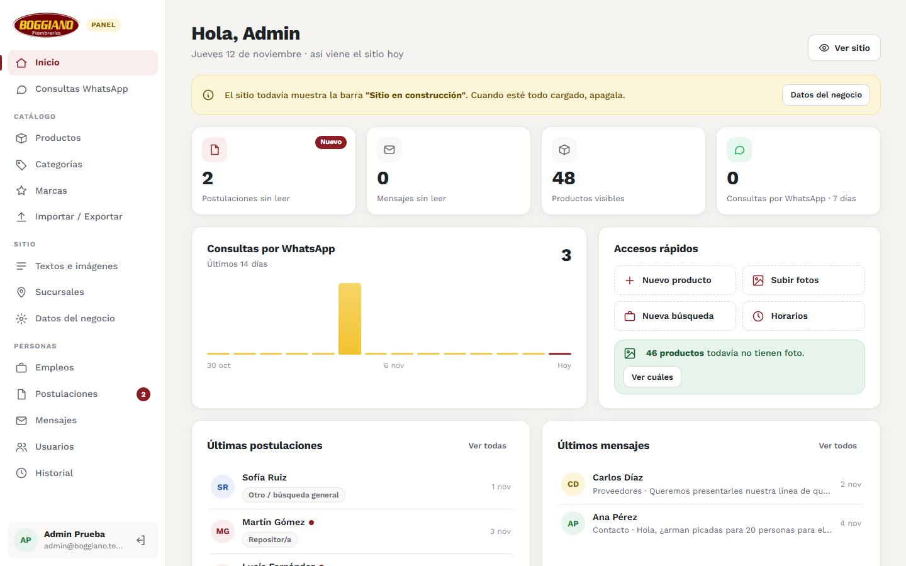

# 1. Entrar al panel

[← Volver al índice](../README.md)

## Cómo entrar

1. Abrí **[boggianofiambrerias.com.ar/admin](https://boggianofiambrerias.com.ar/admin)**.
2. Poné tu email y tu contraseña, y tocá **Ingresar**.

## La pantalla de inicio del panel

- **Arriba:** los cuadros muestran cuántas **postulaciones** y **mensajes sin leer** hay (con la marca **Nuevo** si hay alguno), cuántos productos se ven y cuántas consultas por WhatsApp hubo en la semana. Tocá un cuadro para ir directo.
- **Consultas por WhatsApp:** el gráfico de los últimos 14 días; el día de hoy va en bordó. Al lado del total, cuánto subió o bajó contra los 14 días anteriores. Tocá el gráfico para ver el detalle.
- **Accesos rápidos:** nuevo producto, subir fotos, nueva búsqueda y horarios de las sucursales.
- **Avisos:** te recuerda si el sitio sigue con la barra "Sitio en construcción" y cuántos productos no tienen foto.
- **Últimas postulaciones y últimos mensajes:** el punto bordó al lado del nombre marca lo que todavía no abriste.
- **Menú:** en la computadora está a la izquierda, agrupado en **Catálogo**, **Sitio** y **Personas**. En el celular se abre con el botón **☰** de arriba a la izquierda y se cierra tocando afuera.
- **Números en el menú:** al lado de *Postulaciones* y *Mensajes* indican lo que todavía no abriste.
- **Ver sitio** (arriba a la derecha) abre la web en otra pestaña. **Salir** es el ícono de la flecha, abajo del menú, al lado de tu nombre.

## Bueno saber

- **La sesión se cierra sola** después de 8 horas sin usar el panel. Si estabas editando, volvé a entrar y repetí el último cambio.
- **Bloqueo por intentos:** después de **5 contraseñas mal puestas**, el ingreso queda bloqueado **15 minutos** desde esa conexión. Es una protección contra intentos de entrar a la fuerza. Esperá y probá de nuevo.
- **Si aparece "La sesión venció o el formulario es inválido",** tenías la página abierta hacía mucho. Volvé atrás, recargá y guardá de nuevo.
- **¿Olvidaste la contraseña?** En la pantalla de ingreso tocá **¿Olvidaste tu contraseña?** y escribí tu email. Te llega un link para elegir una nueva: sirve **una sola vez** y vence en **1 hora**. Si no te llega, mirá en spam, o pedile a otro usuario del panel que te cree uno nuevo ([Usuarios](11-usuarios.md)).
- **Se usa igual en el celular y en la computadora.**
