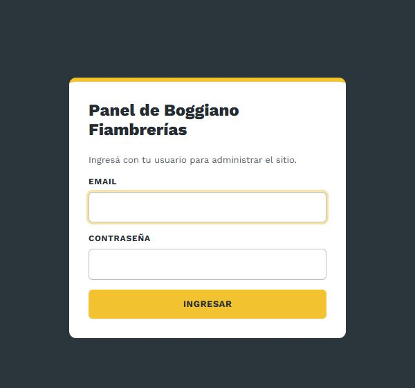
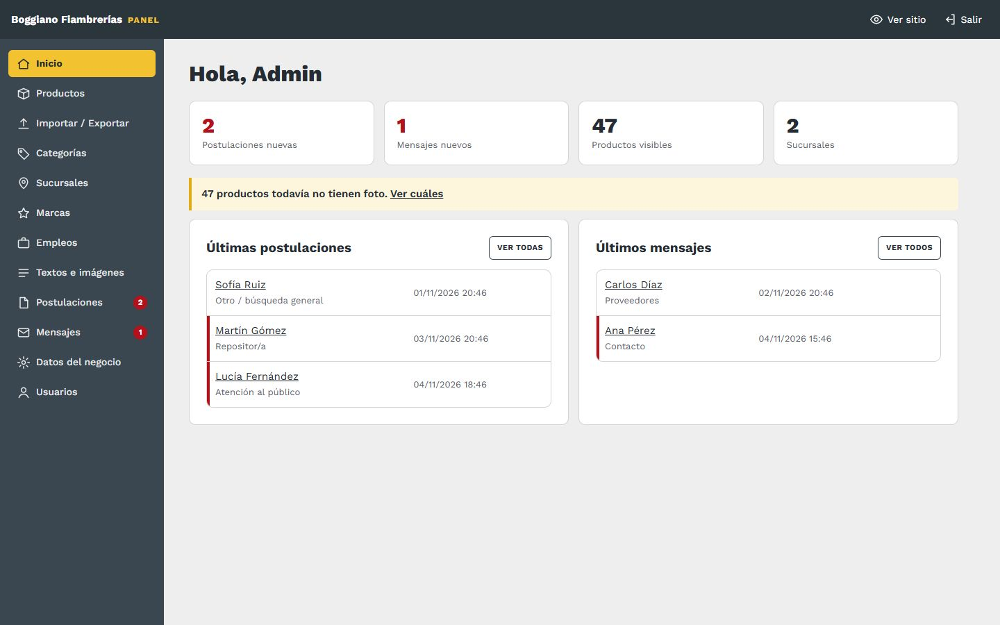

# 1. Entrar al panel

[← Volver al índice](../README.md)

## Cómo entrar

1. Abrí **[boggianofiambrerias.com.ar/admin](https://boggianofiambrerias.com.ar/admin)**.
2. Poné tu email y tu contraseña, y tocá **Ingresar**.

## La pantalla de inicio del panel

- **Arriba:** los cuadros muestran cuántas **postulaciones** y **mensajes nuevos** hay. Si hay alguno, el número sale en rojo. Tocá el cuadro para ir directo.
- **Avisos:** te recuerda si el sitio sigue con la barra "Versión de prueba" y cuántos productos no tienen foto.
- **Menú:** en la computadora está a la izquierda. En el celular es una barra que se desliza de costado, debajo del título.
- **Números rojos en el menú:** al lado de *Postulaciones* y *Mensajes* indican lo que todavía no abriste.
- **Arriba a la derecha:** **Ver sitio** abre la web en otra pestaña, y **Salir** cierra la sesión.

## Bueno saber

- **La sesión se cierra sola** después de 8 horas sin usar el panel. Si estabas editando, volvé a entrar y repetí el último cambio.
- **Bloqueo por intentos:** después de **5 contraseñas mal puestas**, el ingreso queda bloqueado **15 minutos** desde esa conexión. Es una protección contra intentos de entrar a la fuerza. Esperá y probá de nuevo.
- **Si aparece "La sesión venció o el formulario es inválido",** tenías la página abierta hacía mucho. Volvé atrás, recargá y guardá de nuevo.
- **No hay "olvidé mi contraseña".** Si te la olvidás, otro usuario del panel te puede crear uno nuevo. Por eso conviene que haya al menos dos ([ver Usuarios](11-usuarios.md)).
- **Se usa igual en el celular y en la computadora.**
