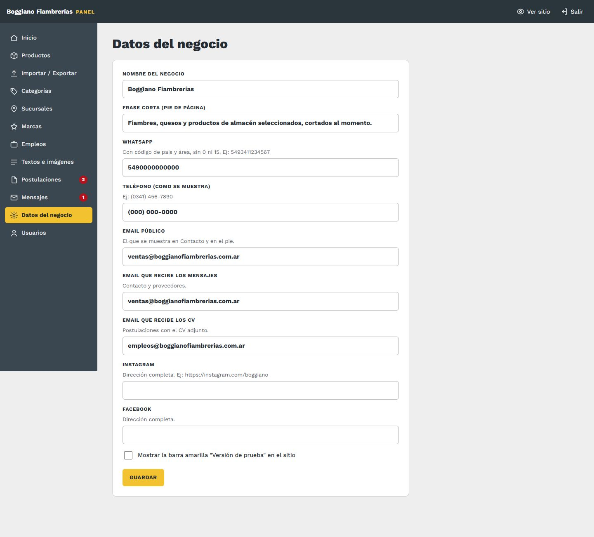
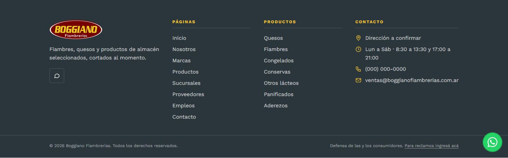

# 2. Datos del negocio

[← Volver al índice](../README.md)

**En el panel:** menú **Datos del negocio**.

## Qué es cada campo y dónde se ve en el sitio

| Campo | Cómo se escribe | Qué cambia en el sitio |
|---|---|---|
| **Nombre del negocio** | Boggiano Fiambrerías | Título de la pestaña del navegador, pie de página, textos del formulario de empleo y avisos por mail |
| **Frase corta** | Una línea | Debajo del logo, en el pie de página |
| **WhatsApp** | Con código de país y área, **sin 0 ni 15**. Ej: `5493411234567`. Si ponés espacios o guiones, se sacan solos | Los botones generales de WhatsApp: "Consultar" del encabezado, el botón verde flotante, el del menú en el celular y "Consultar por WhatsApp" de Inicio y Contacto. Los de cada sucursal usan el WhatsApp de esa sucursal, si lo tiene cargado |
| **Teléfono** | Como querés que se lea. Ej: `(0341) 456-7890` | Pie de página y página Contacto. En el celular se puede tocar para llamar |
| **Email público** | El que ven los clientes | Pie de página y página Contacto |
| **Email que recibe los mensajes** | Normalmente `ventas@` | A esta casilla llegan los avisos de **Contacto**, **Franquicias** y **Proveedores** |
| **Email que recibe los CV** | Normalmente `empleos@` | A esta casilla llegan las **postulaciones**, con el CV adjunto |
| **Instagram / Facebook** | La dirección completa, empezando con `https://` | Íconos en el pie de página. Si quedan vacíos, el ícono no aparece |
| **Verificación de Google Search Console** | La etiqueta que da Google (o solo el código). Opcional | Le prueba a Google que el sitio es tuyo. Ver [Google y monitoreo](15-google-y-monitoreo.md) |
| **Barra "Sitio en construcción"** | Casilla | Prendida: aparece una franja amarilla arriba de todo el sitio que dice "Sitio en construcción". **Apagala cuando el sitio esté terminado** |
| **Páginas que se ven en el sitio** | Un tilde por página | Ver abajo |

Tocá **Guardar** al final. Si un dato tiene mal el formato (un mail sin @ o una red que no empieza con `https://`), el panel te avisa cuál es. El resto se guarda igual.

*En el pie se ven el nombre, la frase, las redes, la primera sucursal, el teléfono y el email público.*

## Páginas que se ven en el sitio

Al final de la pantalla hay un tilde por cada página del menú: Nosotros, Marcas, Productos, Sucursales, Franquicias, Sandwichería, Proveedores, Empleos y Contacto. **Inicio** no tiene tilde: siempre se ve.

Sirve para ocultar una página mientras la estás armando y mostrarla cuando esté lista. Sacás el tilde, tocás **Guardar**, y esa página:

- sale del menú de arriba y del pie;
- deja de aparecer en Google (sale del mapa del sitio);
- pierde los botones que llevaban a ella desde otras páginas, como "Ver productos" o "Ver sucursales";
- si alguien entra por su dirección, lo lleva a Inicio.

Si ocultás **Productos**, además desaparecen el buscador de arriba y las categorías y productos destacados de Inicio. Si ocultás **Marcas**, desaparece la franja de marcas de Inicio.

Para volver a mostrarla, poné el tilde y **Guardar**. No se pierde nada: los textos, productos y fotos quedan como estaban. Cada cambio queda en el [Historial](16-historial.md) y se puede deshacer.

## Bueno saber

- El **número de WhatsApp es el más importante:** es como los clientes consultan por los productos. Después de cambiarlo, probá tocar "Consultar" arriba de todo desde tu celular.
- Los mails de los formularios salen siempre desde la casilla configurada en el hosting (`ventas@`). Si un cliente escribe por Contacto, en tu casilla vas a ver "responder a" con el mail del cliente: respondés directo.
