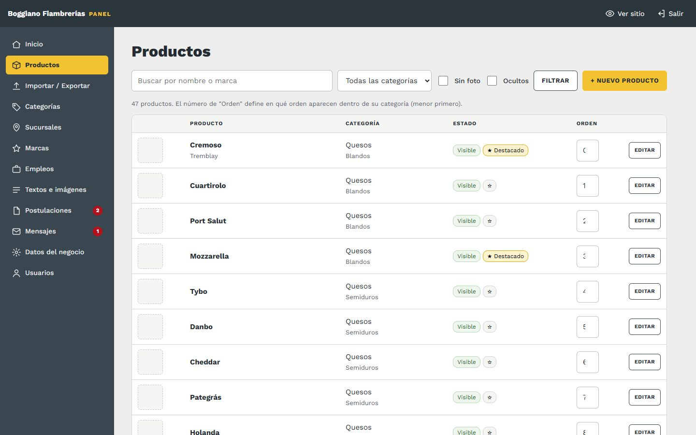
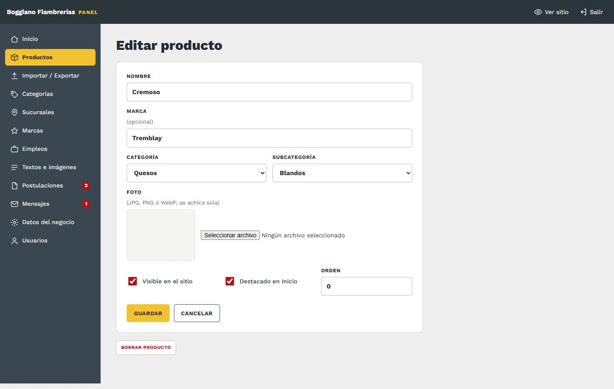
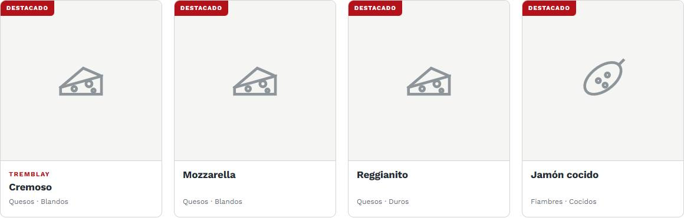
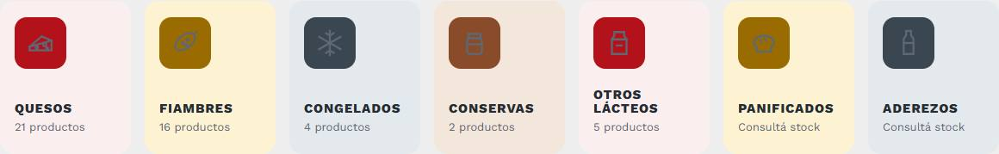
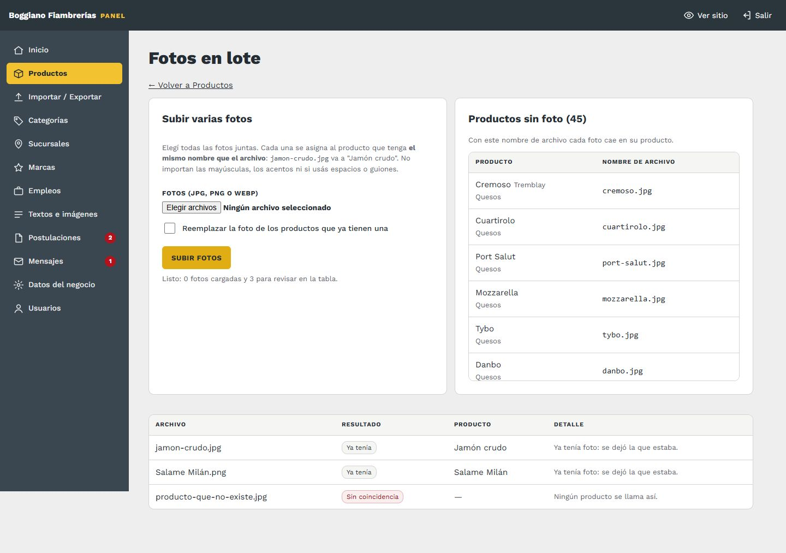

# 3. Productos

[← Volver al índice](../README.md)

**En el panel:** menú **Productos**. Para cargar muchos de una vez, mirá [Importar y exportar](04-importar-exportar.md).

## La lista: un árbol plegable

Los productos están ordenados como en el sitio, en **tres niveles**: **categoría › subcategoría › tipo** (ej. Quesos › Blandos › Cremoso). Cada nivel se abre y se cierra tocando su nombre, y muestra cuántos productos tiene. Así no hace falta scrollear todo el catálogo: abrís solo la parte que estás tocando.

- **Abrir todo / Cerrar todo:** arriba a la derecha. El panel **recuerda qué dejaste abierto** para la próxima vez.
- **+ Nuevo acá:** en cada nivel. Abre un producto nuevo que ya viene con esa categoría, subcategoría o tipo elegidos.
- **Buscar:** por nombre o marca. Con las casillas **Sin foto** y **Ocultos** ves solo esos. Al filtrar, se abren solas las partes donde hay resultados.
- **Visible / Oculto:** tocá la etiqueta para cambiarlo en el momento.
- **★ Destacado:** tocá la estrella para marcarlo o desmarcarlo.
- **Editar:** tocá el nombre del producto.

### Cambiar muchos de una vez

Tildá la casilla de cada producto (o **"Elegir los N de…"** para tomar todos los de una categoría, subcategoría o tipo). Abajo aparece una barra oscura con lo que podés hacer con los elegidos:

| Botón | Qué hace |
|---|---|
| **Mover** | Los pasa a la categoría, subcategoría o tipo que elijas en la lista de al lado |
| **Ocultar / Mostrar** | Los saca del sitio o los vuelve a mostrar |
| **★ Destacar / Quitar ★** | Los marca o desmarca como destacados |
| **Borrar** | Los borra con sus fotos. Pide confirmación y **no se puede deshacer** |
| **Ninguno** | Destilda todo |

## Cargar o editar un producto

Tocá **+ Nuevo producto** o **Editar**.

| Campo | Para qué |
|---|---|
| **Nombre** | Obligatorio. Ej: "Jamón crudo" |
| **Marca** | Opcional. Se muestra debajo del nombre y entra en el buscador |
| **Ubicación** | Obligatoria. Una sola lista con todo: la categoría sola ("Quesos (sin subcategoría)"), una subcategoría ("Blandos") o un tipo ("Blandos › Cremoso"). Si falta una subcategoría o un tipo, se crea en [Categorías](05-categorias.md) |
| **Foto** | JPG, PNG o WebP, de hasta 15 MB. **Se achica sola** para que el sitio cargue rápido. "Quitar la foto" la borra |
| **Visible en el sitio** | Destildado, el producto no se ve, pero queda guardado |
| **Destacado en Inicio** | Lo muestra en "Los que más salen" |
| **Orden** | Posición dentro del catálogo (menor primero) |

- **Guardar y cargar otro:** solo en productos nuevos. Guarda y deja el formulario vacío, **con la misma ubicación**, para seguir cargando productos del mismo tipo.
- **Borrar producto:** abajo de todo, en rojo. **No se puede deshacer.** Si solo querés que no se vea, destildá "Visible".

## Qué cambia en el sitio

| Lo que tocás | Dónde se nota |
|---|---|
| Nombre, marca, foto | La tarjeta del producto en **Productos**, y en Inicio si es destacado |
| Ubicación | En qué filtro del catálogo aparece (categoría, subcategoría y tipo), y el conteo de productos de cada categoría en Inicio |
| Visible | Aparece o desaparece del catálogo, del buscador y de Inicio |
| Destacado | **Los primeros 4** destacados, según el orden, salen en Inicio, en "Los que más salen", con la etiqueta roja *Destacado* |
| Orden | El orden de las tarjetas en el catálogo y cuáles 4 destacados se ven en Inicio |

**La tarjeta de cada producto** muestra la foto a todo el ancho, la **marca** arriba del nombre y, en gris, dónde está en el catálogo (categoría · subcategoría · tipo). **No tiene botón de WhatsApp propio:** para consultar se usa el botón verde del encabezado o el flotante.

| Así se ven los destacados en Inicio | Así se ven las categorías en Inicio |
|---|---|
|  |  |

## Subir muchas fotos juntas (Fotos en lote)

**En el panel:** **Productos → Fotos en lote**.

1. **Nombrá cada foto como el producto.** `jamon-crudo.jpg` va a "Jamón crudo", y `Salame Milán.png` va a "Salame Milán". No importan las mayúsculas, los acentos ni si usás espacios o guiones.
2. **Si hay dos productos con el mismo nombre** (por ejemplo, dos quesos azules de marcas distintas), agregá la marca: `queso-azul-la-paulina.jpg`.
3. **Elegí todas las fotos juntas** y tocá **Subir fotos**. Se suben de a una y la tabla de abajo muestra qué pasó con cada una.

A la derecha está la lista de **productos sin foto, con el nombre de archivo que tiene que tener cada foto**.

| Resultado | Qué significa |
|---|---|
| **Cargada** | Se asignó al producto |
| **Ya tenía** | El producto ya tenía foto y se dejó la anterior. Para reemplazarla, tildá "Reemplazar la foto de los productos que ya tienen una" |
| **Sin coincidencia** | Ningún producto se llama como el archivo. Revisá el nombre |
| **Varios posibles** | Hay más de un producto con ese nombre. Agregale la marca al nombre del archivo |
| **Error** | El archivo no es una imagen válida (JPG, PNG o WebP) |

## Sobre las fotos

- **Sin foto,** la tarjeta muestra un dibujo de la categoría (un queso, un salame…). El sitio funciona igual, pero con fotos se ve mucho mejor.
- **Para que queden parejas:** fotos **cuadradas o casi**, con el producto centrado y fondo claro.
- **Se pueden sacar con el celular:** el panel las achica y guarda además una versión chica para las tarjetas, así el catálogo carga rápido aunque tenga muchas fotos. No hace falta editarlas antes.
- **Para encontrar las que faltan:** en Inicio del panel hay un aviso con cuántos productos no tienen foto, y el filtro **Sin foto** de la lista te muestra cuáles son.
