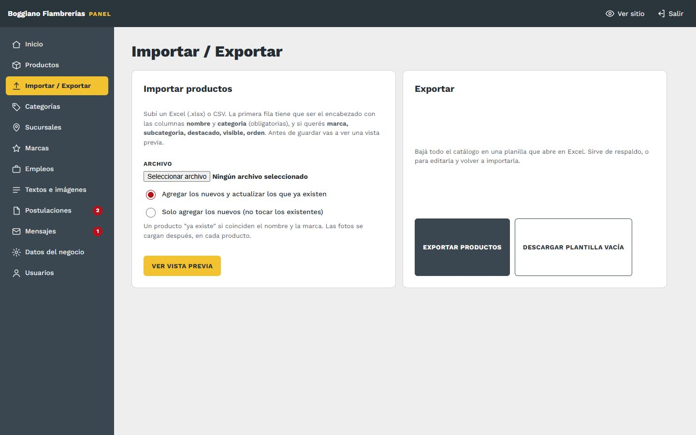
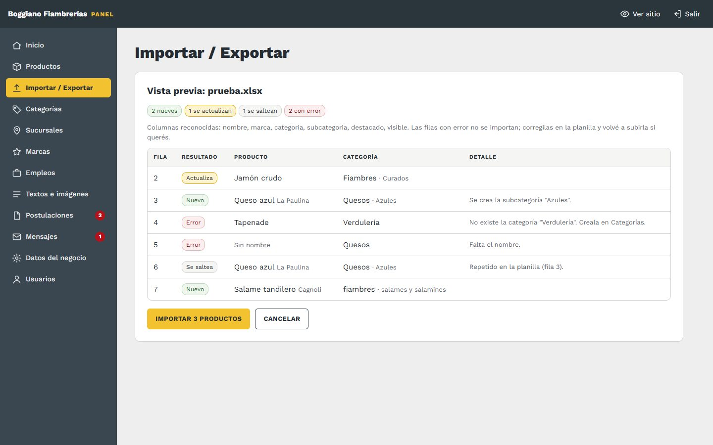

# 4. Importar y exportar productos (Excel)

[← Volver al índice](../README.md)

**En el panel:** menú **Importar / Exportar**.

## Armar la planilla

Lo más fácil: tocá **Descargar plantilla vacía**, abrila en Excel y completala. La **primera fila** tiene que ser el encabezado, con estas columnas (el orden no importa):

| Columna | Obligatoria | Qué va |
|---|---|---|
| `nombre` | Sí | Nombre del producto |
| `categoria` | Sí | Una categoría que **ya exista** en el panel. Da igual si va con mayúsculas o acentos: "Quesos", "quesos" o "QUESOS" |
| `marca` | No | Marca del producto |
| `subcategoria` | No | Si no existe dentro de esa categoría, **se crea sola** |
| `tipo` | No | El tercer nivel, dentro de la subcategoría (ej. Quesos › Blandos › **Cremoso**). Si no existe, **se crea solo**. Necesita que la fila tenga `subcategoria`: si no, la fila marca error |
| `destacado` | No | `si` / `no`. Vacío = no |
| `visible` | No | `si` / `no`. Vacío = sí |
| `orden` | No | Un número |

Para el "sí" también sirven `s`, `x`, `1` o `verdadero`.

**Formatos:**
- Acepta **Excel (.xlsx)** y **CSV**, de hasta 5 MB. Si tenés un `.xls` viejo, abrilo en Excel y guardalo como `.xlsx`.
- Lee **la primera hoja** del Excel.
- El CSV que guarda Excel en Windows se lee con los acentos bien.

## Importar en dos pasos

1. **Subí el archivo** y elegí el modo:
   - **Agregar los nuevos y actualizar los que ya existen:** el más común.
   - **Solo agregar los nuevos:** no toca los productos que ya están cargados.

   Tocá **Ver vista previa**.

2. **Revisá la vista previa.** Todavía **no se guardó nada**. Cada fila dice qué va a pasar con ella:

| Resultado | Qué significa |
|---|---|
| **Nuevo** | Se va a crear |
| **Actualiza** | Ya existe un producto con ese **nombre y marca**, y se actualizan su categoría, subcategoría, tipo, destacado, visible y orden |
| **Se saltea** | Ya existe y elegiste "solo agregar", o está repetido dentro de la misma planilla |
| **Error** | Falta el nombre, o la categoría no existe. Esa fila no entra |

Si está bien, tocá **Importar N productos**. Si no, **Cancelar**: corregí la planilla y volvé a subirla.

## Bueno saber

- **Cuándo un producto "ya existe":** cuando coinciden el **nombre y la marca**. No importan las mayúsculas ni los acentos ("Jamón Crudo" = "jamon crudo"). Si cambiás el nombre en la planilla, el panel lo toma como un producto nuevo.
- **Fotos:** la importación no carga fotos. Se suben después, en cada producto ([Productos](03-productos.md)).
- **Categorías:** las que no existen no se crean solas: creala antes en [Categorías](05-categorias.md). Las subcategorías y los tipos sí se crean solos.
- **La vista previa vence** si la dejás abierta más de un día. Subí la planilla de nuevo.

## Exportar

- **Exportar productos:** baja todo el catálogo en una planilla que abre en Excel, con las mismas columnas. Sirve:
  - **como respaldo:** conviene bajarla de vez en cuando;
  - **para editar todo junto:** la cambiás en Excel y la volvés a importar con "agregar y actualizar".
- **Descargar plantilla vacía:** el encabezado y dos filas de ejemplo.
