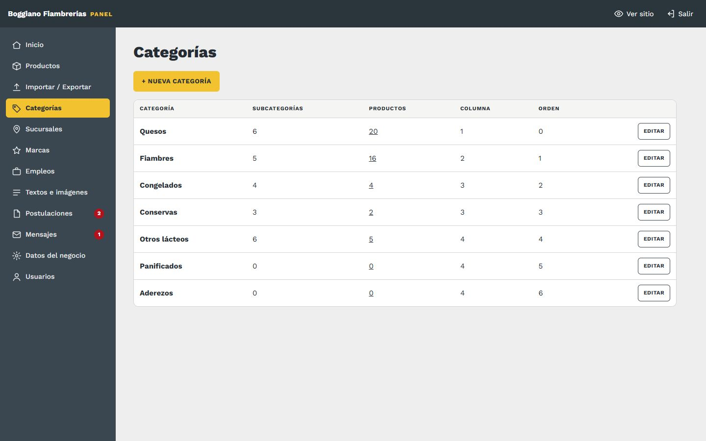
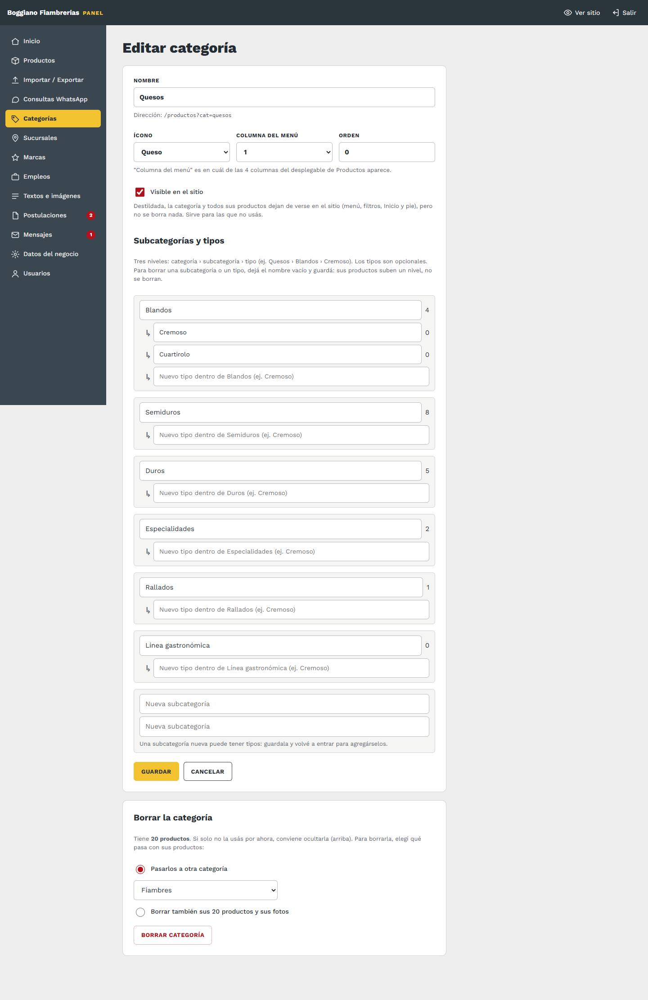
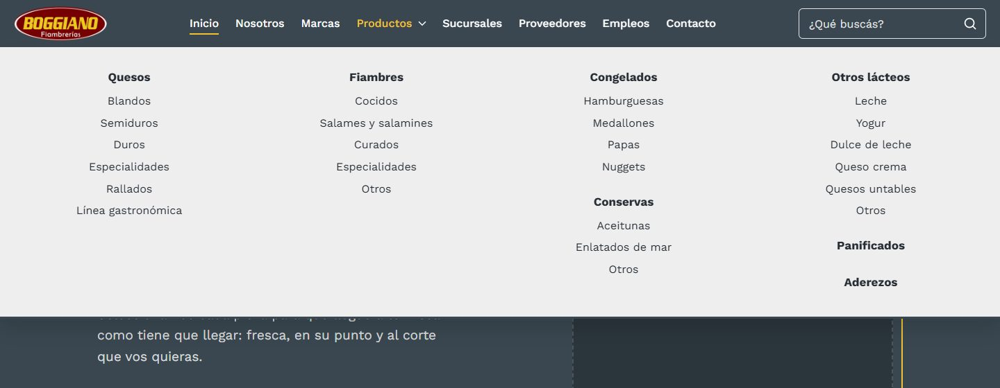
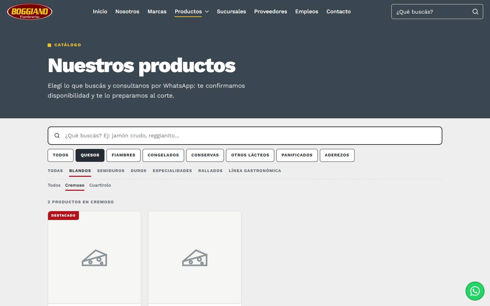

# 5. Categorías y menú de productos

[← Volver al índice](../README.md)

**En el panel:** menú **Categorías**.

La lista muestra cada categoría con su **estado** (Visible u Oculta), cuántas subcategorías, tipos y productos tiene, en qué columna del menú aparece y su orden. Tocando el número de productos, vas a esos productos filtrados.

## Ocultar una categoría que no usás

Tocá la etiqueta **Visible** de la lista (pasa a **Oculta**), o destildá **Visible en el sitio** al editarla.

- Una categoría oculta **desaparece del sitio**: del menú "Productos", de los filtros del catálogo, de Inicio y del pie. **Sus productos tampoco se ven.**
- **No se borra nada:** productos, fotos y subcategorías quedan guardados. Para que vuelva, tocá **Oculta** y queda visible otra vez.
- Es lo más seguro para una categoría que no tenés por ahora, o que es de temporada.

## Editar una categoría

| Campo | Qué cambia en el sitio |
|---|---|
| **Nombre** | El botón de filtro del catálogo, la ficha de Inicio, el menú desplegable "Productos" y la lista del pie |
| **Ícono** | El dibujo de la ficha en Inicio (en bordó, sobre un círculo rosado), y el de los productos de esa categoría que no tienen foto |
| **Columna del menú** | En cuál de las **4 columnas** del desplegable "Productos" aparece |
| **Orden** | El orden de los filtros, de las fichas de Inicio y del pie (menor primero) |
| **Subcategorías y tipos** | Los filtros debajo de la categoría en el catálogo (una fila para subcategorías y, si la subcategoría tiene tipos, otra fila más abajo), y la lista del desplegable |

*El desplegable "Productos" del sitio: cada categoría con sus subcategorías, en la columna elegida.*

## Subcategorías y tipos (tres niveles)

Los productos se ordenan en **categoría › subcategoría › tipo**. Por ejemplo: **Quesos › Blandos › Cremoso**. Los tipos son **opcionales**: una subcategoría sin tipos funciona como siempre.

En la pantalla de edición, cada subcategoría está en un recuadro, con sus tipos debajo (marcados con ↳). El número a la derecha es cuántos productos tiene cada una.

- **Renombrar:** cambiá el texto y guardá. Los productos que la tenían la siguen teniendo.
- **Agregar un tipo:** escribilo en el campo "Nuevo tipo dentro de…" de esa subcategoría y guardá.
- **Agregar una subcategoría:** usá los campos "Nueva subcategoría" del final. Para ponerle tipos, guardala y volvé a entrar.
- **Borrar:** dejá el campo **vacío** y guardá. **Sus productos suben un nivel, no se borran:** los de un tipo pasan a su subcategoría, y los de una subcategoría quedan en la categoría sola (si la subcategoría tenía tipos, también se borran).
- **El orden** en que aparecen es el orden de la lista.
- **Qué producto va en cada una** se elige en el producto (campo **Ubicación**) o de a muchos con **Mover** en la lista de [Productos](03-productos.md).

En el catálogo, al elegir una subcategoría con tipos aparece una **tercera fila de filtros** con sus tipos. El link queda así: `/productos?cat=quesos&sub=Blandos&tipo=Cremoso`.

## Nueva categoría y borrar

- **+ Nueva categoría:** el nombre define la dirección del filtro, por ejemplo `/productos?cat=quesos`. **Esa dirección no cambia después**, aunque renombres la categoría, para que los links compartidos sigan andando.
- **Borrar categoría:** está al final de la pantalla de edición. Si tiene productos, elegís qué pasa con ellos:
  - **Pasarlos a otra categoría:** quedan sin subcategoría, porque las subcategorías eran de la que se borra.
  - **Borrar también sus productos** y sus fotos.

  Si te equivocaste, se recupera desde [Historial → Deshacer](16-historial.md). Si dudás, ocultala.
