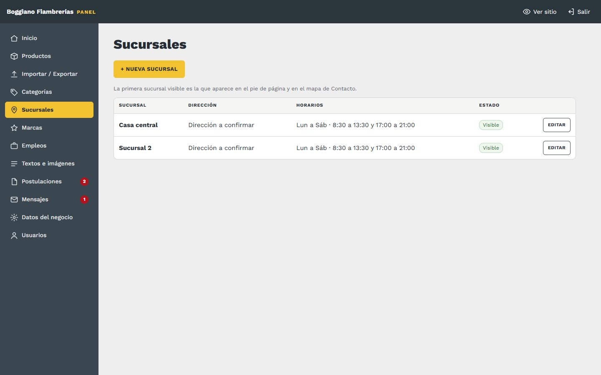
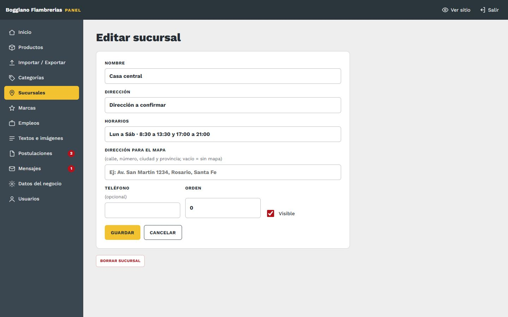
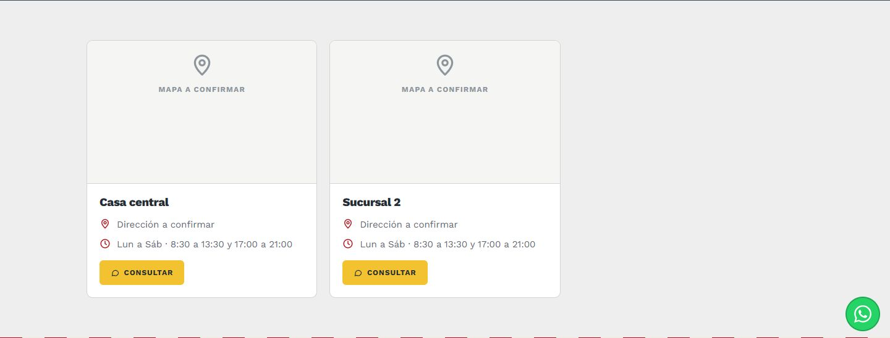

# 6. Sucursales

[← Volver al índice](../README.md)

**En el panel:** menú **Sucursales**.

## Editar una sucursal

| Campo | Qué va | Qué cambia en el sitio |
|---|---|---|
| **Nombre** | Ej: "Casa central", "Sucursal Centro" | Título de la tarjeta |
| **Dirección** | Como querés que se lea | Tarjeta de la sucursal, página Contacto y pie |
| **Horarios** | Ej: "Lun a Sáb · 8:30 a 13:30 y 17:00 a 21:00" | Tarjeta, Contacto y pie |
| **Dirección para el mapa** | Calle, número, **ciudad y provincia**, como la buscarías en Google Maps | Muestra el **mapa** y el botón **Cómo llegar**. Vacío = sin mapa |
| **Teléfono** | Opcional | Queda guardado (por ahora no se muestra en la tarjeta) |
| **Orden** | Número | Orden de las tarjetas (menor primero) |
| **Visible** | Casilla | Destildada, la sucursal no aparece en ningún lado |

## Qué cambia en el sitio

- **Página Sucursales:** una tarjeta por sucursal visible, con mapa, dirección, horarios, **Cómo llegar** (abre Google Maps con el recorrido) y **Consultar**, que abre WhatsApp con el nombre de esa sucursal en el mensaje.
- **Página Contacto:** la lista de sucursales, y el **mapa de la primera**.
- **Pie de página:** la dirección y los horarios de la **primera sucursal visible**.

Por eso, a la **casa central** ponele el orden más bajo, para que sea la primera.

## Para que el mapa salga bien

- Escribí la dirección completa: "Av. San Martín 1234, Rosario, Santa Fe".
- Si el mapa marca otro lugar, probá escribirla como sale en Google Maps cuando buscás el local.
