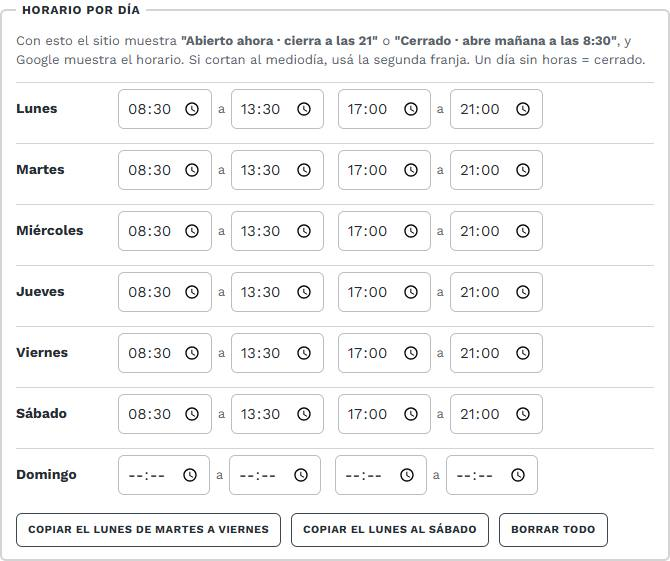
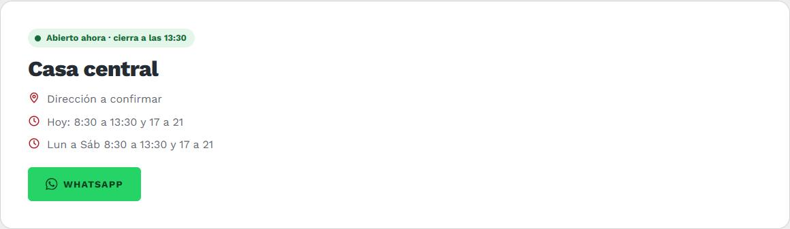

# 6. Sucursales

[← Volver al índice](../README.md)

**En el panel:** menú **Sucursales**.

## Editar una sucursal

| Campo | Qué va | Qué cambia en el sitio |
|---|---|---|
| **Nombre** | Ej: "Casa central", "Sucursal Centro" | Título de la tarjeta |
| **Dirección** | Como querés que se lea | Tarjeta de la sucursal, página Contacto y pie |
| **Horario por día** | Para cada día, la hora de apertura y de cierre. Si cortan al mediodía, usá la **segunda franja** (ej. 8:30 a 13:30 y 17:00 a 21:00). Un día sin horas = cerrado | El cartel **"Abierto ahora · cierra a las 21"** o **"Cerrado · abre mañana a las 8:30"**, la línea **"Hoy: …"** y el horario que muestra Google |
| **Horarios en texto** | Opcional. Si lo dejás vacío, **se arma solo** con el horario por día (ej. "Lun a Sáb 8:30 a 13:30 y 17 a 21") | Tarjeta, Contacto y pie |
| **Dirección para el mapa** | Calle, número, **ciudad y provincia**, como la buscarías en Google Maps | Muestra el **mapa** y el botón **Cómo llegar**. Vacío = sin mapa |
| **WhatsApp de la sucursal** | Opcional. Como lo copiás del celular, ej. `+54 9 3704 36-6506` | El botón **WhatsApp** de esa sucursal abre el chat con **ese número**, y el teléfono se muestra en su tarjeta. Vacío = usa el WhatsApp general de [Datos del negocio](02-datos-del-negocio.md) |
| **Orden** | Número | Orden de las tarjetas (menor primero) |
| **Visible** | Casilla | Destildada, la sucursal no aparece en ningún lado |

### Cargar el horario rápido

Completá el **lunes** y usá los botones de abajo: **Copiar el lunes de martes a viernes** y **Copiar el lunes al sábado**. Después corregí el día que sea distinto y dejá vacío el domingo si cierran. **Borrar todo** vacía la grilla.

El estado se calcula con la **hora de Argentina** en el momento en que la persona mira la página. Los feriados no se tienen en cuenta: un feriado se ve como un día normal.

## Qué cambia en el sitio

- **Inicio:** la **primera sucursal visible** sale destacada en "Te esperamos", con mapa, el cartel de abierto o cerrado, el horario de hoy y los botones **Cómo llegar** y **WhatsApp**. Su estado también aparece arriba de todo en la portada.

- **Página Sucursales:** una tarjeta por sucursal visible, con mapa, el cartel de abierto o cerrado, dirección, horarios, **Cómo llegar** (abre Google Maps con el recorrido) y **WhatsApp**, que abre el chat con el nombre de esa sucursal en el mensaje.
- **Página Contacto:** la lista de sucursales, y el **mapa de la primera**.
- **Pie de página:** la dirección y los horarios de la **primera sucursal visible**.

Por eso, a la **sucursal principal** ponele el orden más bajo, para que sea la primera.

Si una sucursal no tiene horario por día cargado, el cartel de abierto o cerrado simplemente no aparece.

## Para que el mapa salga bien

- Escribí la dirección completa: "Av. San Martín 1234, Rosario, Santa Fe".
- Si el mapa marca otro lugar, probá escribirla como sale en Google Maps cuando buscás el local.
