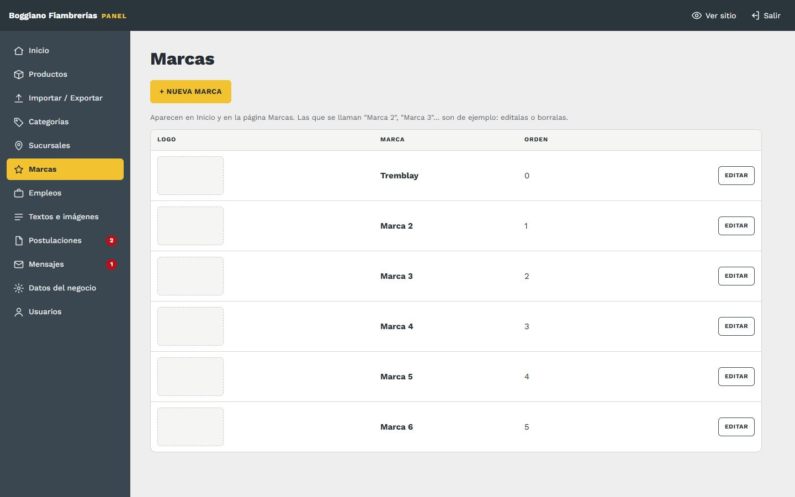

# 7. Marcas

[← Volver al índice](../README.md)

**En el panel:** menú **Marcas**.

| Campo | Qué va |
|---|---|
| **Nombre** | El nombre de la marca |
| **Logo** | PNG con **fondo transparente**, ideal. También JPG o WebP. Se achica solo |
| **Orden** | Posición (menor primero) |

## Qué cambia en el sitio

Las marcas aparecen en **Inicio**, en "Trabajamos con las mejores", y en la página **Marcas**:

- **Con logo:** se muestra el logo.
- **Sin logo:** se muestra el nombre en letras.
- **Las que se llaman "Marca 2", "Marca 3"…** son de ejemplo y se ven como un recuadro gris que dice "Logo de marca". Editalas con las marcas reales o borralas.

> Esta lista es solo para mostrar con quién trabajás. La marca de cada producto se carga en el producto ([Productos](03-productos.md)).
