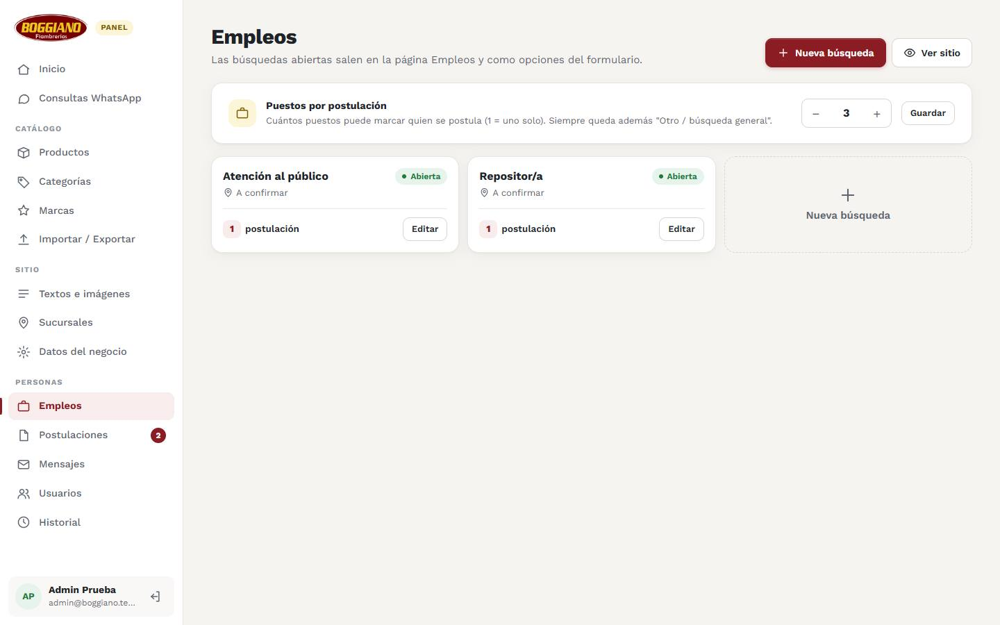
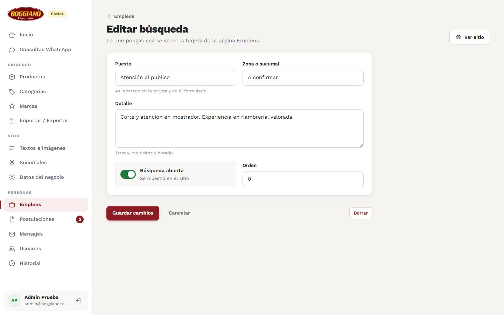
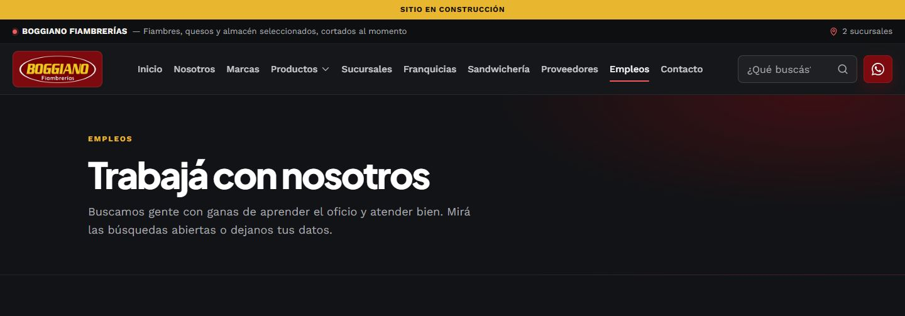
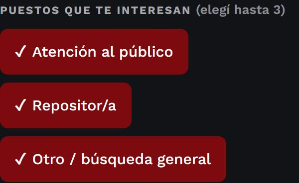
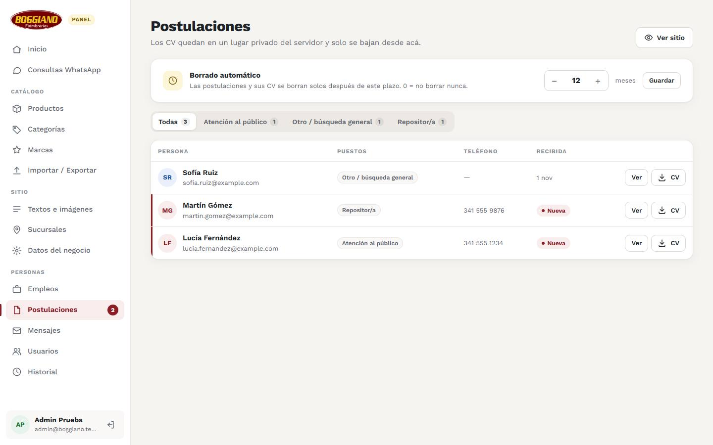
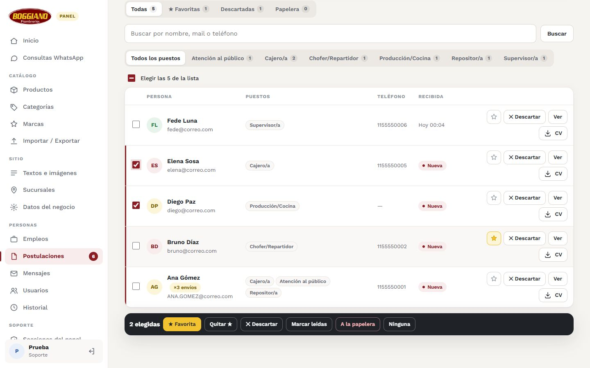
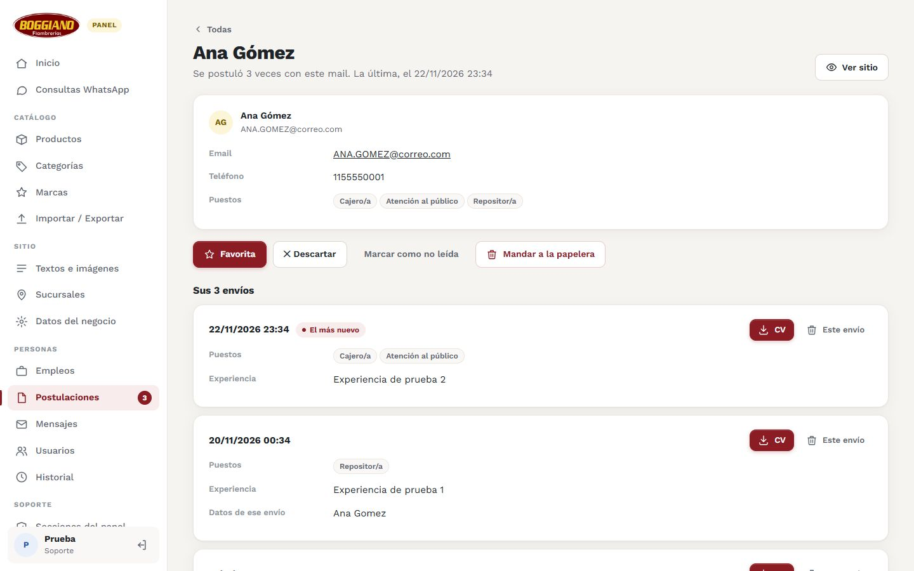
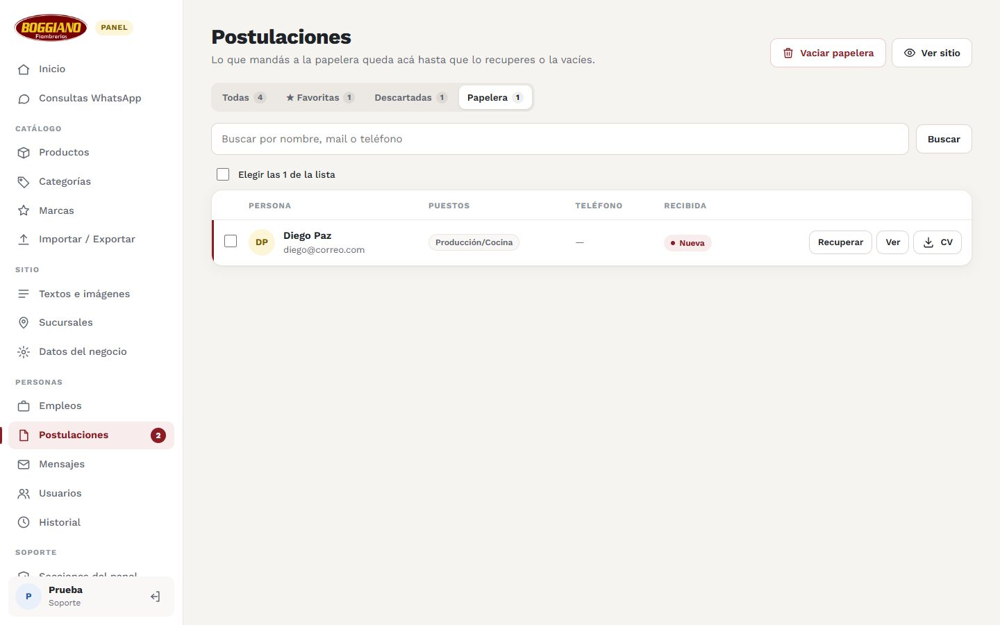

# 8. Empleos y postulaciones

[← Volver al índice](../README.md)

## Búsquedas abiertas

**En el panel:** menú **Empleos**. Cada búsqueda es una tarjeta con su zona, si está abierta o cerrada y cuántas postulaciones tiene. **Nueva búsqueda** está arriba a la derecha y en la última tarjeta.

| Campo | Qué va |
|---|---|
| **Puesto** | Ej: "Atención al público" |
| **Zona o sucursal** | Dónde es el puesto |
| **Detalle** | Tareas, requisitos, horario |
| **Búsqueda abierta** | Interruptor: prendido (verde) se muestra en el sitio; apagado queda cerrada |
| **Orden** | Posición (menor primero) |

**Qué cambia en el sitio:** en la página **Empleos** aparece una tarjeta por cada búsqueda abierta, con su botón **Postularme**. El puesto también aparece como opción en el formulario. Siempre queda además la opción **"Otro / búsqueda general"**, para quien quiera dejar el CV igual.

- **Sin búsquedas abiertas,** la página dice "No hay búsquedas abiertas" e invita a dejar el CV igual.
- **Cerrar o borrar una búsqueda** no borra las postulaciones que ya llegaron.

### Postularse a varios puestos

Quien se postula puede marcar **varios puestos a la vez**: por ejemplo, Cajero/a, Atención al público y Repositor/a. Así alguien con experiencia en más de un área no tiene que mandar el CV varias veces.

- **Cuántos puede marcar:** arriba de las búsquedas en Empleos, en el recuadro **"Puestos por postulación"**: subilo o bajalo con **−** y **+** y tocá **Guardar**. Viene en **3**; va de 1 a 10. Con **1**, elige un solo puesto, como antes.
- **En el sitio,** el formulario dice "elegí hasta 3" (o el número que pongas). Al llegar al tope, los demás puestos quedan en gris hasta que desmarque alguno.
- **El botón Postularme** de cada búsqueda deja ese puesto marcado en el formulario.

## Postulaciones

**En el panel:** menú **Postulaciones**. El número rojo indica cuántas no abriste todavía (sin contar las descartadas ni las de la papelera).

**Una fila por persona.** Si alguien se postula varias veces con el mismo mail (aunque lo escriba con mayúsculas o espacios distintos), sus envíos aparecen juntos en una sola fila, con la marca **"×3 envíos"**. La fila muestra todos los puestos que eligió en sus envíos y se marca **Nueva** si alguno no lo abriste.

- **Pestañas:** **Todas** (incluye las favoritas) · **★ Favoritas** · **Descartadas** · **Papelera**. El número de cada una cuenta personas.
- **Buscar:** por nombre, mail o teléfono.
- **Filtrar por puesto:** los botones debajo del buscador, dentro de la pestaña en la que estés. Una postulación a varios puestos cuenta en cada uno: la de Cajero/a, Atención al público y Repositor/a aparece en esas tres. En Empleos, el número de postulaciones de cada tarjeta cuenta igual (tocalo para ver esas postulaciones).
- **★ (estrella):** la suma a Favoritas. Tocala de nuevo para sacarla. No recarga la página.
- **✕ Descartar:** la pasa a Descartadas, sin borrarla. Ya no aparece en Todas. Desde Descartadas, **Recuperar** la devuelve.
- **Ver:** abre el detalle. Al abrirlo, se marcan como leídos todos sus envíos.
- **CV:** descarga el CV del envío más nuevo.

### Elegir varias a la vez

Cada fila tiene una casilla a la izquierda, y arriba de la lista está **"Elegir las N de la lista"** para marcarlas todas (con el buscador o un puesto elegido, marca sólo las que se ven). Al marcar alguna aparece abajo una barra con lo que podés hacer con todas juntas:

- **★ Favorita** / **Quitar ★**
- **✕ Descartar** (en Descartadas, **Recuperar**)
- **Marcar leídas**
- **A la papelera**
- **Ninguna:** desmarca todo.

Lo que hagas se aplica a **todos los envíos** de cada persona elegida.

### Detalle de una persona

Arriba, los datos del envío más nuevo y los botones **Favorita**, **Descartar**, **Marcar como no leída** y **Mandar a la papelera**. Abajo, **cada envío por separado**, con su fecha, sus puestos, su experiencia y **su CV**. Si una persona mandó el mismo CV dos veces, **"Este envío"** manda a la papelera sólo ese envío y deja los demás.

### Papelera

- **Nada se borra al mandarlo a la papelera:** queda ahí, con su CV, hasta que vos decidas.
- **Recuperar:** la devuelve a Postulaciones (o a Descartadas, si estaba descartada).
- **Borrar para siempre:** desde la casilla de cada fila o desde el detalle. Borra la postulación y su CV. **No se puede deshacer.**
- **Vaciar papelera:** el botón de arriba a la derecha borra para siempre todo lo que hay en la papelera.
- Si alguien que está en la papelera se vuelve a postular, el envío nuevo aparece en Postulaciones como cualquier otro.

### Cómo llega una postulación

1. **La persona completa el formulario** de la página Empleos y adjunta su CV: **PDF, Word o una foto (JPG, PNG o WebP), de hasta 15 MB**. La foto sirve para quien postula desde el celular con el CV en papel. El CV puede estar en Drive, WhatsApp u otra app del celular: el sitio lo copia apenas lo eligen, así el envío no se corta. Tiene que aceptar el uso de sus datos.
   - **Si algo falla al enviar,** el cartel dice qué pasó: que se cortó la conexión, que el celular no dejó abrir el archivo (entonces hay que descargarlo al teléfono y elegirlo de nuevo) o que hubo un error del servidor.
2. **El sitio revisa que el archivo sea de verdad lo que dice ser.** Un archivo que no es PDF, Word ni una foto, aunque tenga ese nombre, se rechaza.
3. **La postulación queda en el panel** y **llega por mail** a la casilla de CV de [Datos del negocio](02-datos-del-negocio.md), con el CV adjunto. Si el mail falla por algún motivo, igual queda en el panel.
4. **Si ya se había postulado con ese mail,** el mail avisa qué número de envío es, y en el panel el envío nuevo se junta con los anteriores. Si la tenías en Favoritas o en Descartadas, sigue ahí.

### Datos personales

- **Dónde quedan los CV:** en un lugar **privado** del servidor. No se pueden abrir desde internet: solo se descargan desde el panel.
- **Ley 25.326:** los CV son datos personales protegidos por la Ley de Protección de Datos Personales. Si alguien pide que borren sus datos, mandá su postulación a la papelera y borrala para siempre desde ahí.
- **Borrado automático:** arriba de la lista de Postulaciones, en el recuadro **Borrado automático**, elegís con **−** y **+** cada cuántos meses se borran solas las postulaciones viejas, con su CV, **también las que están en la papelera**. Viene en **12 meses**, y **0** es no borrar nunca. Se hace sola una vez por día, la primera vez que alguien entra al panel. Al guardar un plazo nuevo, se borran en el momento las que ya lo superaron.
