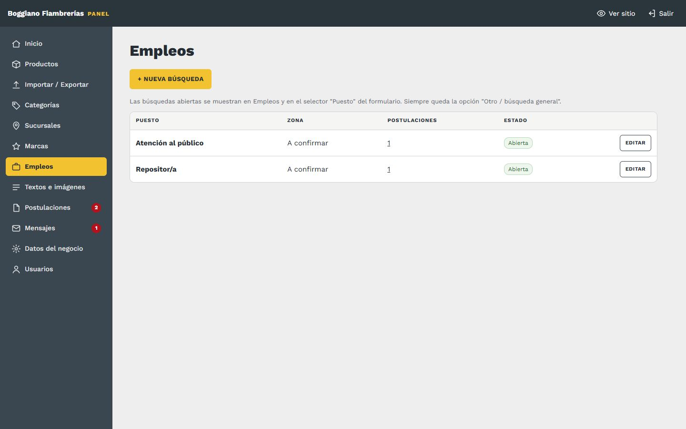
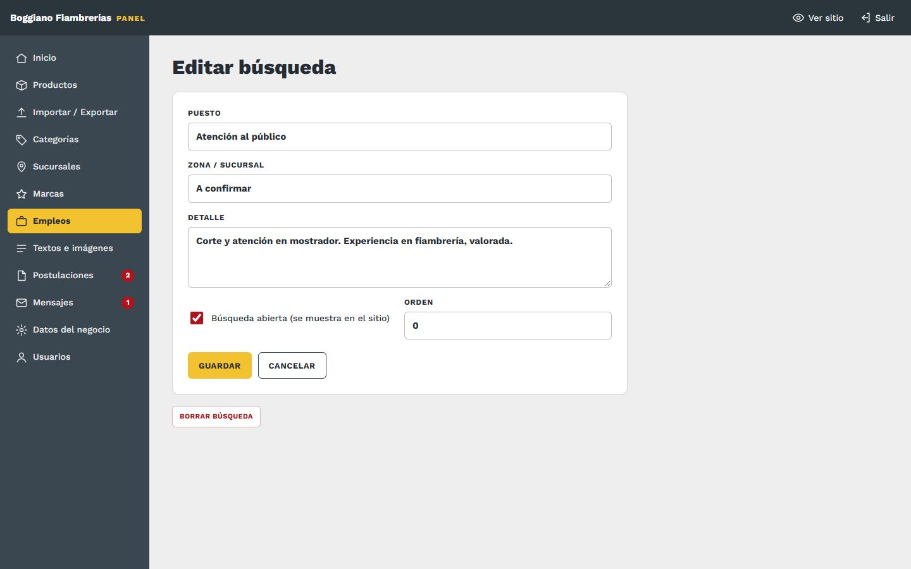
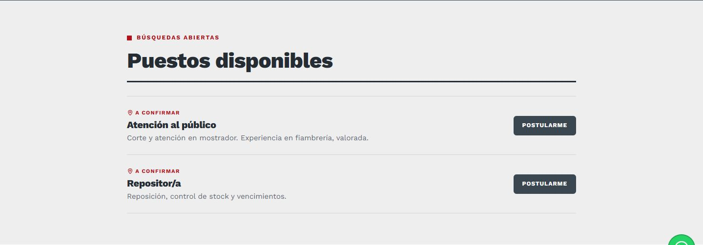
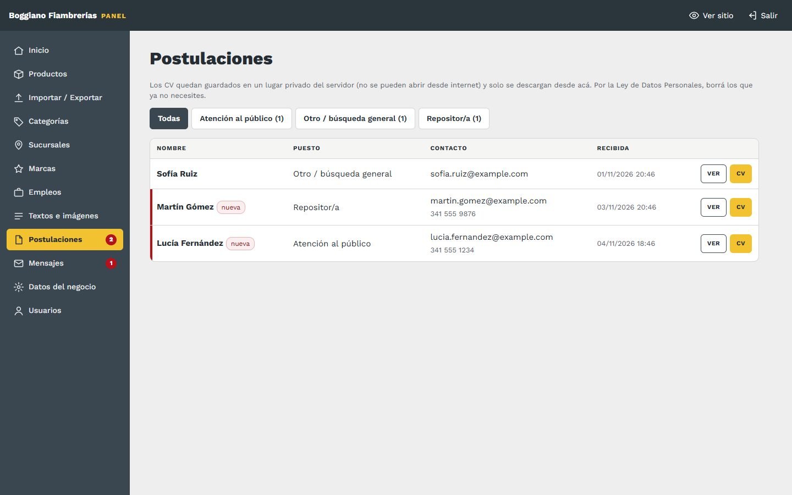

# 8. Empleos y postulaciones

[← Volver al índice](../README.md)

## Búsquedas abiertas

**En el panel:** menú **Empleos**.

| Campo | Qué va |
|---|---|
| **Puesto** | Ej: "Atención al público" |
| **Zona / sucursal** | Dónde es el puesto |
| **Detalle** | Tareas, requisitos, horario |
| **Búsqueda abierta** | Tildada se muestra en el sitio; destildada queda cerrada |
| **Orden** | Posición (menor primero) |

**Qué cambia en el sitio:** en la página **Empleos** aparece una tarjeta por cada búsqueda abierta, con su botón **Postularme**. El puesto también se suma al selector "Puesto" del formulario. Siempre queda además la opción **"Otro / búsqueda general"**, para quien quiera dejar el CV igual.

- **Sin búsquedas abiertas,** la página dice "No hay búsquedas abiertas" e invita a dejar el CV igual.
- **Cerrar o borrar una búsqueda** no borra las postulaciones que ya llegaron.

## Postulaciones

**En el panel:** menú **Postulaciones**. El número rojo indica cuántas no abriste todavía.

- **Filtrar por puesto:** los botones de arriba.
- **Ver:** abre el detalle, con nombre, mail, teléfono, puesto, experiencia, fecha y el CV. Al abrirla, se marca como leída.
- **CV:** lo descarga directamente.
- **Marcar como no leída:** para acordarte de volver a verla.
- **Borrar postulación y CV:** borra los dos. **No se puede deshacer.**

### Cómo llega una postulación

1. **La persona completa el formulario** de la página Empleos y adjunta su CV: **PDF o Word, de hasta 5 MB**. Tiene que aceptar el uso de sus datos.
2. **El sitio revisa que el archivo sea un CV de verdad.** Un archivo que no es PDF ni Word, aunque tenga ese nombre, se rechaza.
3. **La postulación queda en el panel** y **llega por mail** a la casilla de CV de [Datos del negocio](02-datos-del-negocio.md), con el CV adjunto. Si el mail falla por algún motivo, igual queda en el panel.

### Datos personales

- **Dónde quedan los CV:** en un lugar **privado** del servidor. No se pueden abrir desde internet: solo se descargan desde el panel.
- **Ley 25.326:** los CV son datos personales protegidos por la Ley de Protección de Datos Personales. **Borrá los que ya no necesites,** y si alguien pide que borren sus datos, borrá su postulación.
