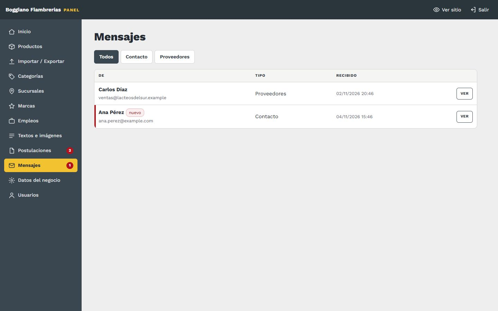

# 9. Mensajes

[← Volver al índice](../README.md)

**En el panel:** menú **Mensajes**. El número rojo indica cuántos no abriste.

Acá llegan los formularios de dos páginas del sitio:

| Formulario | Página | Qué trae |
|---|---|---|
| **Contacto** | Contacto | Nombre, email y mensaje |
| **Proveedores** | Proveedores | Empresa, contacto, email, teléfono, rubro y mensaje |

Cada mensaje queda en el panel **y** llega por mail a la casilla de mensajes de [Datos del negocio](02-datos-del-negocio.md).

## Qué podés hacer

- **Filtrar** por tipo: Todos, Contacto o Proveedores.
- **Ver:** abre el mensaje completo y lo marca como leído.
- **Responder por mail:** abre tu correo con el mail de la persona ya cargado. También podés responder directo el aviso que te llegó a la casilla.
- **Marcar como no leído** o **Borrar**.

## Bueno saber

- **El formulario frena a los robots,** y deja hasta 5 envíos cada 10 minutos desde una misma conexión.
- **Las consultas por productos** llegan por WhatsApp, no por acá. Este es el canal para consultas generales y para proveedores.
