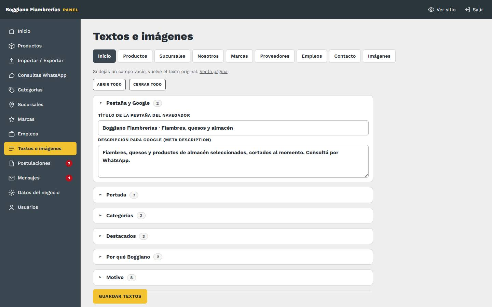
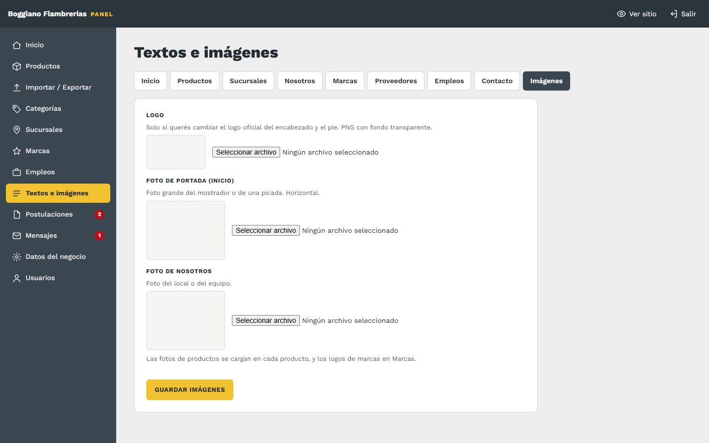
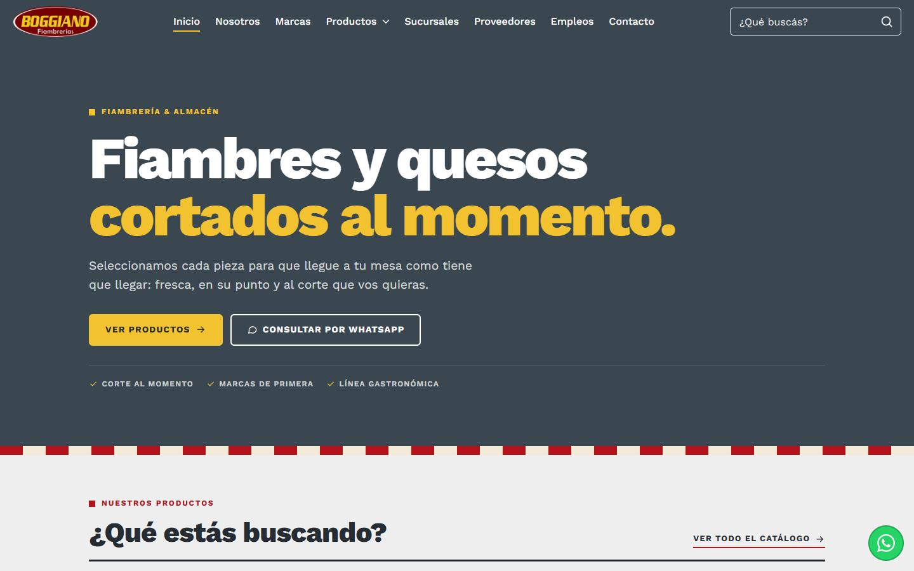

# 10. Textos e imágenes

[← Volver al índice](../README.md)

**En el panel:** menú **Textos e imágenes**. Hay una pestaña por página del sitio, y una de **Imágenes**.

## Textos

- **Los campos están agrupados por sección de la página** (Portada, Motivos, Secciones…), cada una plegable, para no tener que scrollear todo. Cada sección muestra cuántos campos tiene y, en amarillo, **cuántos cambiaste** respecto del texto original. **Abrir todo / Cerrar todo** arriba.
- **Cada campo dice dónde aparece.** Por ejemplo, "Portada · título" o "Motivo 2 · texto".
- **El botón Guardar textos queda fijo abajo,** siempre a mano mientras bajás.
- **Si dejás un campo vacío,** vuelve el texto original. Así no hay forma de romper nada: siempre podés volver atrás.
- **Los saltos de línea se respetan** en los textos largos.
- **Guardar textos** guarda la pestaña entera. Después tocá **Ver la página** para revisar cómo quedó.

### Qué se puede cambiar en cada página

| Pestaña | Qué textos tiene |
|---|---|
| **Inicio** | Título de la pestaña del navegador, descripción para Google, la portada (etiqueta, título, título en amarillo, texto y los 3 sellos), los títulos de las secciones y los 4 motivos de "Por qué Boggiano" |
| **Productos** | Descripción para Google y el encabezado (etiqueta, título y texto) |
| **Sucursales** | Descripción para Google y el encabezado |
| **Nosotros** | Descripción para Google, encabezado, **historia** (título y dos párrafos), los 4 valores y la banda final |
| **Marcas** | Descripción para Google, encabezado y la banda "¿Tenés una marca?" |
| **Proveedores** | Descripción para Google, encabezado, "Qué buscamos", los 3 requisitos y el título del formulario |
| **Empleos** | Descripción para Google, encabezado, el título de las búsquedas y el del formulario |
| **Contacto** | Descripción para Google, encabezado y el título del formulario |

**"Descripción para Google"** es el texto que aparece debajo del título cuando el sitio sale en Google, y al compartir el link por WhatsApp o redes. Conviene una o dos frases que digan qué hay en esa página.

> **Pendiente:** en **Nosotros**, la historia todavía dice "Texto de historia a confirmar". Es lo primero para cambiar acá.

## Imágenes

| Imagen | Dónde se ve | Recomendación |
|---|---|---|
| **Logo** | Encabezado y pie de página | Ya está el **logo oficial**. Subí otro solo si querés cambiarlo, en PNG con fondo transparente. "Quitar" vuelve al oficial |
| **Foto de portada** | Inicio, al lado del título grande. También es la imagen que se ve al **compartir el link** del sitio | Horizontal, del mostrador o de una picada. Sin foto, la portada muestra solo el título y al compartir se ve el logo |
| **Foto de Nosotros** | Página Nosotros, al lado de la historia | Del local o del equipo |

### Portada con o sin foto

En la misma pestaña **Imágenes**, en **Portada de Inicio**:

- **Con foto:** la foto de portada se muestra a la derecha del título.
- **Sin foto:** solo el título, más grande y a todo el ancho. La foto queda guardada, así que volver a "Con foto" la muestra de nuevo.

**Si no hay ninguna foto de portada cargada,** la portada se muestra sola sin foto, sin el recuadro vacío.

- **Formatos:** JPG, PNG o WebP, de hasta 15 MB. Se achican solas.
- **Vista previa:** apenas elegís el archivo se ve en el panel, y se guarda con **Guardar imágenes**.
- **Otras fotos:** las de productos se cargan en [Productos](03-productos.md) y los logos de marcas en [Marcas](07-marcas.md).
