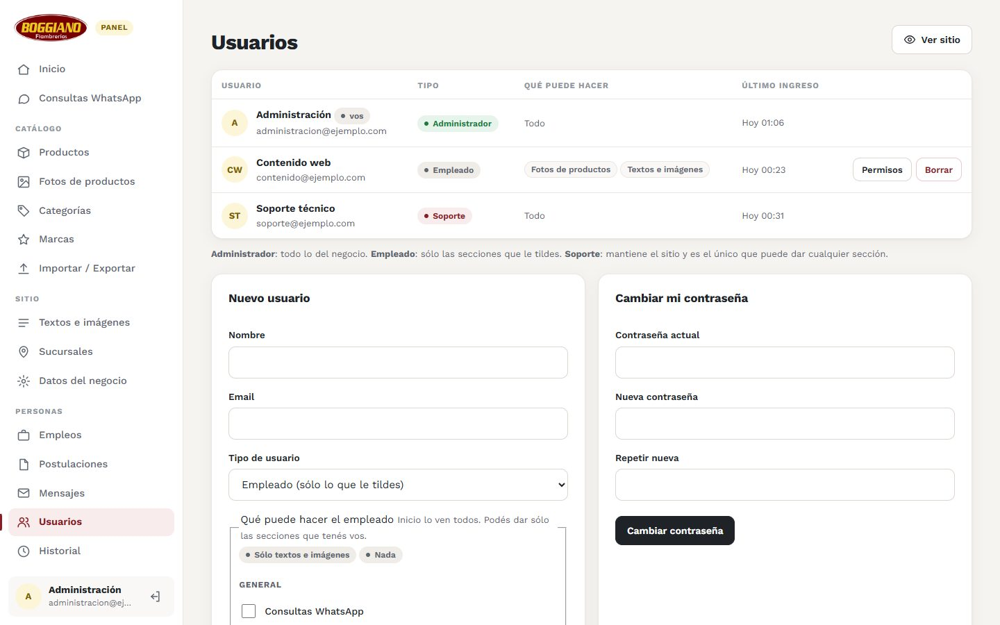

# 11. Usuarios

[← Volver al índice](../README.md)

**En el panel:** menú **Usuarios**.

## Roles: Administrador y Soporte

Cada usuario tiene un rol, que se ve en la columna **Rol**:

- **Administrador**: carga y cambia lo del negocio (productos, sucursales, búsquedas, postulaciones, mensajes, textos…), **en las secciones que tenga permitidas**.
- **Soporte**: es quien mantiene el sitio. Ve todo y decide qué secciones del panel están habilitadas. Las secciones nuevas aparecen recién cuando soporte las habilita.

Si buscás una sección que no aparece en el menú, pedísela a soporte. Que una sección esté apagada no borra nada de lo que tenga cargado.

Un administrador no puede borrar a un usuario de soporte ni cambiar roles.

## Qué puede hacer cada usuario

La columna **Qué puede hacer** muestra las secciones que tiene cada persona: **Todo**, o sólo algunas, por ejemplo *Textos e imágenes · Fotos de productos* para alguien que carga el contenido del sitio y no toca productos, búsquedas ni usuarios.

- Al crear un usuario, en **Qué puede hacer** tildás sus secciones. Los atajos **Todo**, **Sólo textos e imágenes** y **Nada** las marcan de una vez.
- Para cambiarlas después, tocá **Permisos** en su fila.
- Podés dar **sólo las secciones que tenés vos**. Si le das **Usuarios** a un empleado, él también puede crear usuarios y elegir sus permisos, siempre dentro de lo que tiene.
- No podés cambiar ni borrar a alguien que tenga secciones que vos no tenés, ni a soporte, ni tus propios permisos.
- Nombrar a alguien **Soporte** lo hace sólo soporte.
- Esa persona ve en el menú sólo lo suyo, y si entra con el link de otra sección vuelve al inicio.
- En **Historial**, cada uno deshace sólo los cambios de las secciones que tiene.

## Crear un usuario

Completá **Nombre**, **Email** y una **contraseña de al menos 10 caracteres**, dos veces, y tocá **Crear usuario**. El email es con lo que esa persona va a entrar: no tiene que ser una casilla del dominio, puede ser su Gmail. Los usuarios nuevos se crean como **Administrador**, con las secciones que les tildes.

Pasale la contraseña por un medio seguro: en persona o por teléfono, no por un mensaje que quede guardado. Pedile que la cambie la primera vez que entre.

## Cambiar tu contraseña

En **Cambiar mi contraseña**: la actual, la nueva dos veces, y **Cambiar contraseña**.

## Borrar un usuario

Botón **Borrar** en su fila. La persona deja de poder entrar enseguida. No podés borrar tu propio usuario ni a uno de soporte, y siempre tiene que quedar al menos uno.

## Si alguien se olvida la contraseña

1. En la pantalla de ingreso, tocá **¿Olvidaste tu contraseña?** y poné el email del usuario.
2. Llega un mail con un link para elegir una contraseña nueva. Sirve una sola vez y vence en 1 hora.
3. Si el mail no llega (por ejemplo, porque el correo del sitio no está andando), otro usuario le **crea uno nuevo** y después borra el viejo. Por eso conviene que haya **al menos dos usuarios**.

Por seguridad, el panel responde lo mismo exista o no ese email, así nadie puede averiguar qué emails tienen usuario.
