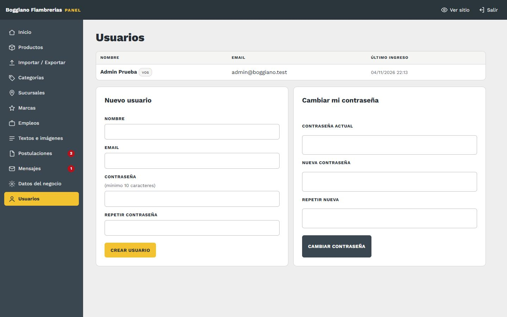

# 11. Usuarios

[← Volver al índice](../README.md)

**En el panel:** menú **Usuarios**.

Todos los usuarios pueden hacer todo en el panel. No hay permisos distintos.

## Crear un usuario

Completá **Nombre**, **Email** y una **contraseña de al menos 10 caracteres**, dos veces, y tocá **Crear usuario**. El email es con lo que esa persona va a entrar: no tiene que ser una casilla del dominio, puede ser su Gmail.

Pasale la contraseña por un medio seguro: en persona o por teléfono, no por un mensaje que quede guardado. Pedile que la cambie la primera vez que entre.

## Cambiar tu contraseña

En **Cambiar mi contraseña**: la actual, la nueva dos veces, y **Cambiar contraseña**.

## Borrar un usuario

Botón **Borrar** en su fila. La persona deja de poder entrar enseguida. No podés borrar tu propio usuario, y siempre tiene que quedar al menos uno.

## Si alguien se olvida la contraseña

1. En la pantalla de ingreso, tocá **¿Olvidaste tu contraseña?** y poné el email del usuario.
2. Llega un mail con un link para elegir una contraseña nueva. Sirve una sola vez y vence en 1 hora.
3. Si el mail no llega (por ejemplo, porque el correo del sitio no está andando), otro usuario le **crea uno nuevo** y después borra el viejo. Por eso conviene que haya **al menos dos usuarios**.

Por seguridad, el panel responde lo mismo exista o no ese email, así nadie puede averiguar qué emails tienen usuario.
