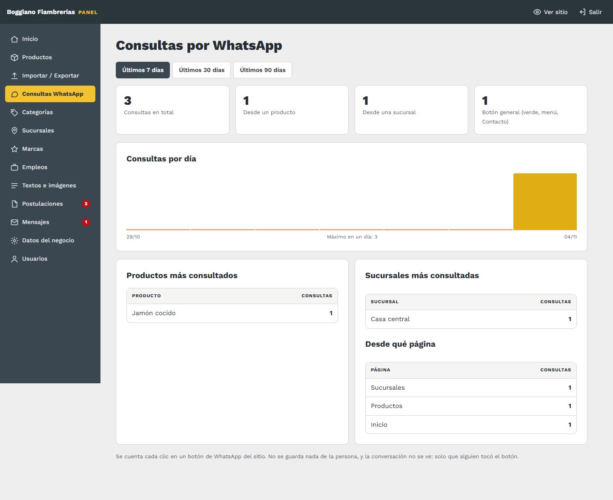

# 14. Consultas por WhatsApp

[← Volver al índice](../README.md)

**En el panel:** menú **Consultas WhatsApp**. También aparece el total de los últimos 7 días en el Inicio del panel.

Cada vez que alguien toca un botón de WhatsApp del sitio, el panel lo anota. Así ves qué productos interesan y si el sitio trae consultas.

## Qué muestra

- **Período:** se elige arriba entre los últimos 7, 30 o 90 días.
- **Totales:** cuántas consultas hubo, separadas según de dónde salieron:
  - **Desde un producto:** el botón "Consultar" de cada producto.
  - **Desde una sucursal:** el botón "Consultar" de cada sucursal.
  - **Botón general:** el botón verde flotante, el del menú en el celular y los de Inicio y Contacto.
- **Consultas por día:** pasá el mouse por una barra para ver el número de ese día.
- **Productos y sucursales más consultados**, y **desde qué página** llegaron.

## Bueno saber

- **Se cuenta el clic, no la conversación.** Si alguien toca el botón y después no escribe, igual cuenta. Es una medida de interés, no de ventas.
- **No se guarda nada de la persona:** ni su número, ni su nombre, ni qué escribió.
- **Clics repetidos:** una misma conexión cuenta hasta 30 clics por hora, así nadie infla los números tocando el botón muchas veces.
- **Para qué sirve:**
  - **Fotos:** los productos que más se consultan son los primeros a los que conviene ponerles foto.
  - **Destacados:** conviene marcar esos productos como destacados, así aparecen en Inicio.
