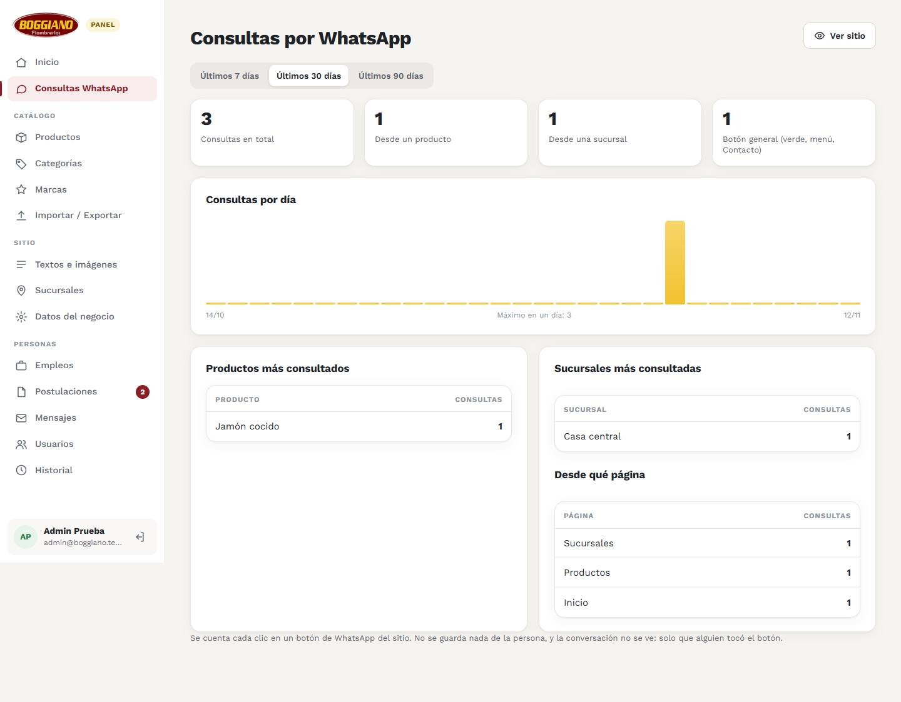

# 14. Consultas por WhatsApp

[← Volver al índice](../README.md)

**En el panel:** menú **Consultas WhatsApp**. También aparece el total de los últimos 7 días en el Inicio del panel.

Cada vez que alguien toca un botón de WhatsApp del sitio, el panel lo anota. Así ves si el sitio trae consultas y por qué sucursal preguntan.

## Qué muestra

- **Período:** se elige arriba entre los últimos 7, 30 o 90 días.
- **Totales:** cuántas consultas hubo, separadas según de dónde salieron:
  - **Desde una sucursal:** el botón "WhatsApp" de cada sucursal (en Inicio y en Sucursales).
  - **Botón general:** el "Consultar" del encabezado, el del menú en el celular, el de Contacto y el del catálogo cuando una búsqueda no encuentra nada.
  - **Desde un producto:** el "Consultar" al pie de cada tarjeta de producto. Abre el mensaje general de WhatsApp, pero acá queda anotado qué producto fue.
- **Consultas por día:** pasá el mouse por una barra para ver el número de ese día.
- **Sucursales y productos más consultados**, y **desde qué página** llegaron.

## Bueno saber

- **Se cuenta el clic, no la conversación.** Si alguien toca el botón y después no escribe, igual cuenta. Es una medida de interés, no de ventas.
- **No se guarda nada de la persona:** ni su número, ni su nombre, ni qué escribió.
- **Clics repetidos:** una misma conexión cuenta hasta 30 clics por hora, así nadie infla los números tocando el botón muchas veces.
- **Para qué sirve:**
  - **Ver si la web trae clientes:** si el total sube después de una publicación en redes o de un cambio en el sitio, funcionó.
  - **Sucursales:** cuál recibe más consultas desde la web, para reforzar la atención por WhatsApp de esa sucursal.
  - **Desde qué página:** si llegan desde Productos, el catálogo se está usando; si es mayormente desde Inicio, conviene destacar bien los productos que más salen.
